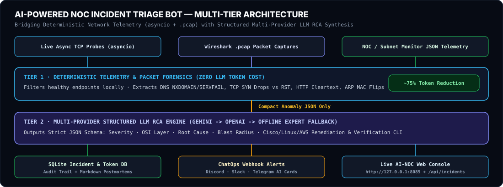

# AI-Powered NOC Incident Triage Bot

[](https://github.com/Shivam-kumar-92/Ai-noc-incident-triage-bot/actions/workflows/ci.yml)

-brightgreen)


> A **zero-dependency hybrid Network Operations + AI Systems platform** that combines **asynchronous network probes (`asyncio`)** and **binary Wireshark `.pcap` forensics** with a **multi-provider structured LLM Root Cause Analysis (RCA) engine** (Gemini -> OpenAI -> Offline Expert Fallback), automated Markdown postmortems, SQLite token-efficiency tracking, Discord/Slack/Telegram alerts, and a live Web Triage Console.



---

## 1. Problem Statement
During L1/L2 NOC outages, engineers waste critical MTTR minutes correlating raw `tcpdump`/`.pcap` traces, port-timeout errors, and subnet health JSON before drafting an incident ticket and finding the right Cisco/Linux/AWS remediation commands. Meanwhile, feeding raw packet dumps directly into LLMs is slow, expensive, and noisy.

**Solution:** A **2-tier pipeline** where **Tier 1** deterministically filters healthy endpoints and extracts high-signal L2–L7 anomalies at **\$0 LLM cost**, escalating only compact JSON evidence to **Tier 2** for structured RCA + remediation runbook synthesis.

---

## 2. Key Engineering Decisions

| Decision | Implementation | Why It Matters |
| :--- | :--- | :--- |
| **Multi-Tier Token Optimization** | Tier-1 `asyncio` probes + binary `.pcap` parser filter healthy traffic locally before Tier-2 LLM synthesis | Cuts LLM token overhead by **~70–85%** and ensures healthy polling sweeps cost \$0. |
| **Graceful Provider Fallback** | `Gemini (gemini-2.0-flash)` -> `OpenAI (gpt-4o-mini)` -> `Offline Expert-System` | Guarantees incident triage never goes dark during upstream LLM outages or air-gapped network incidents. |
| **Strict JSON RCA Schema** | Enforces typed `RCAReport` (`severity`, `osi_layer`, `root_cause`, `blast_radius`, `remediation_steps`, `verification_commands`) | Enables deterministic SQLite storage, ChatOps alert cards, and automated Markdown postmortem export. |
| **Zero External Runtime Deps** | Built purely on Python 3.10+ stdlib (`asyncio`, `urllib`, `sqlite3`, `struct`, `http.server`) | Deploys cleanly on locked-down Linux Bastion hosts, EC2 instances, or minimal Alpine containers. |

---

## 3. Quickstart (Works Immediately Offline or with Gemini/OpenAI)

```bash
# 1. Run full L2/L4/L7 multi-incident triage demo (DNS + ARP Spoofing + TCP Firewall Drop .pcap)
python triage_bot.py --demo

# 2. Export Markdown postmortem reports & JSON RCA bundle
python triage_bot.py --demo --export-md reports/ --json-out reports/rcas.json

# 3. Triage any Wireshark .pcap file directly
python triage_bot.py --triage-pcap samples/sample_firewall_drop.pcap

# 4. Run live async TCP probes and auto-triage any failing ports
python triage_bot.py --probe 1.1.1.1:53,80,443 127.0.0.1:65432

# 5. Launch the embedded Live AI-NOC Web Console (http://127.0.0.1:8085)
python triage_bot.py --demo --dashboard
```

### Enable Live Gemini / OpenAI + Webhook Alerts (Optional)
```bash
cp .env.example .env
# Export GEMINI_API_KEY (or OPENAI_API_KEY) and optional DISCORD_WEBHOOK_URL / SLACK_WEBHOOK_URL / TELEGRAM_*
```

---

## 4. Running Automated Tests
```bash
python -m unittest discover -s tests -v
```
